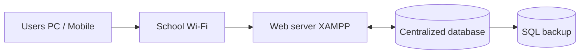
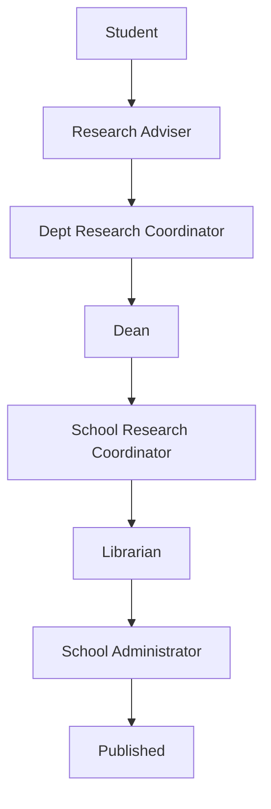

# System flow

## Architecture

## Approval pipeline (low → high)

Statuses: `submitted` → `adviser_reviewed` → `pending` → `dean_review` → `under_review` → `library_review` → `admin_review` → `approved`

## Role processes

### Student
1. Upload dual PDFs (full + blind) to the research adviser  
2. After adviser approval, send to the dept research coordinator  
3. Track progress through dean → research coordinator → librarian → school admin  

### Research Adviser
1. Review submitted manuscripts  
2. Approve so the student can forward to the dept research coordinator  

### Dept Research Coordinator
1. Review studies at `pending`  
2. Save a gate note, then send to the dean  

### Dean
1. Review studies at `dean_review`  
2. Forward to the school research coordinator  

### School Research Coordinator
1. Ethics and manuscript-format checks  
2. Plagiarism / similarity  
3. Send cleared studies to the librarian  

### Librarian
1. Review studies at `library_review`  
2. Send to the school administrator for publish  

### School Administrator
1. Final publish (`admin_review` → `approved`)  
2. Users, settings, audit, SQL backup  

Students have their own dashboard listing approved papers in their department — **abstract only** (no full file). Full manuscript for a student is limited to papers they uploaded.

Research advisers have their own dashboard:
- Assigned advisee papers — **full manuscript**
- Other departments — **title and abstract only** Dept research coordinators have their own dashboard: full manuscripts for every paper in their department; other departments title and abstract only.

Deans have their own dashboard: full manuscripts for every paper in their department; other departments title and abstract only.

School research coordinators have their own dashboard: **all research papers from all departments with complete files**.

Librarians have their own dashboard: **all research papers from all departments with complete files**.

School administrators have their own dashboard: **all research papers from all departments with complete files**.

Account creation:
- Adviser → student, research adviser (own department)
- Dean → student, research adviser, dept research coordinator (own department)
- School administrator → dean, school research coordinator, librarian

## Notifications

All roles receive **in-app status notifications** (bell / Alerts) when workflow events occur—no internet email.
